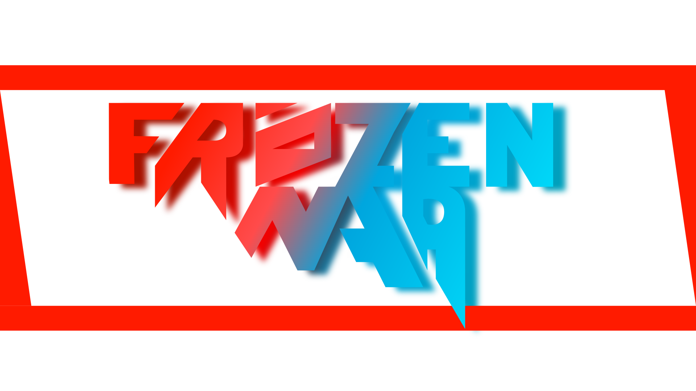

# Frozen War

This repository holds the source code and releases for the Frozen War project.

**Source code (this repository)**

The engine and game executables, licensed under GPL-3.0-or-later with additional terms written below. You may use, study, modify, and redistribute it, provided it stays GPL and you follow those terms.

**Game data (separate)**

Models, textures, sounds, missions, and voices. These are not in this repository and are not GPL; they ship separately under the APL-SA license.

In short: the code is free software, the name is not, and the game data comes separately. This license covers the source code only and grants no rights to the trademarks.


## Quick Start

### Windows
```sh
cmake --preset win-x64-clang-rwdi
cmake --build build/win-x64-clang-rwdi
```

### Linux
```sh
cmake --preset linux-x64-clang-rwdi
cmake --build linux-x64-clang-rwdi
```

## Layout

- [Apps](apps/README.md) - executable targets
- [Engine](engine/README.md) - engine libraries and Rust Trident tooling
- [Master server tools](mserver/README.md) - Rust service and CLI crates
- [Tests](tests/README.md) - test source trees; CI currently compiles them only
- `cmake/` - presets, toolchains, vcpkg triplets, and overlay ports
- `docker/` - container support for service and runtime environments
- `packages/` - ignored local game data staging area
- `resources/` - application icon resources
- `thirdparty/` - vendored third-party headers and sources (NOTE: Might have to remove this!)

## Project Notes

- [Contributing](CONTRIBUTING.md)
- [Credits](CREDITS.md)
- [Third-party notices](THIRD_PARTY_NOTICES.md)
- [Vendored dependencies](thirdparty/README.md)

## License

The source in this repository is licensed under the **GNU General Public License
v3.0 *or later***, with additional terms under **Section 7** of the GPL. See [`LICENSE`](LICENSE) for the
full text.
This license does not grant you any right to use **REDACTED** (NOTE: I do not have the right to use those names!)

The [`thirdparty/`](thirdparty) directory is **excluded** from the project's GPL
license: it contains vendored third-party code (glad, the RenderDoc API header)
under their own respective licenses — see [`thirdparty/README.md`](thirdparty/README.md).
Dependencies pulled in via vcpkg ([`vcpkg.json`](vcpkg.json)) likewise remain under
their own licenses.

### Game data / assets — Arma Public License Share Alike (APL-SA)

Game data and assets (models, textures, sounds, missions, etc.) are **not part of
this repository** and are **not** covered by the GPL. They are released separately
by Bohemia Interactive under the **Arma Public License Share Alike (APL-SA)**:

- APL-SA license text: <https://www.bohemia.net/community/licenses/arma-public-license-share-alike>

### Getting game data to run what you build

The compiled binaries need game data to run. You can obtain the **free Demo game
data** on Steam:

- *Arma: Cold War Assault Remastered* Demo on Steam: <https://store.steampowered.com/app/4819000>

The full game data ships with the retail game. Whatever you do with assets is
governed by the APL-SA linked above; whatever you do with this source is governed by
the GPL with additional terms per Section 7 in [`LICENSE`](LICENSE).


## Contributing

In short: open an issue for:
- Bugs
- Suggested new features
- Suggested improvements

Keep issues limited to one bug/feature/improvement. 
Pull requests should be for one issue, and bigger pull requests will have to be split into multiple ones that respect the one issue rule.
See [`CONTRIBUTING.md`](CONTRIBUTING.md) for more information.
